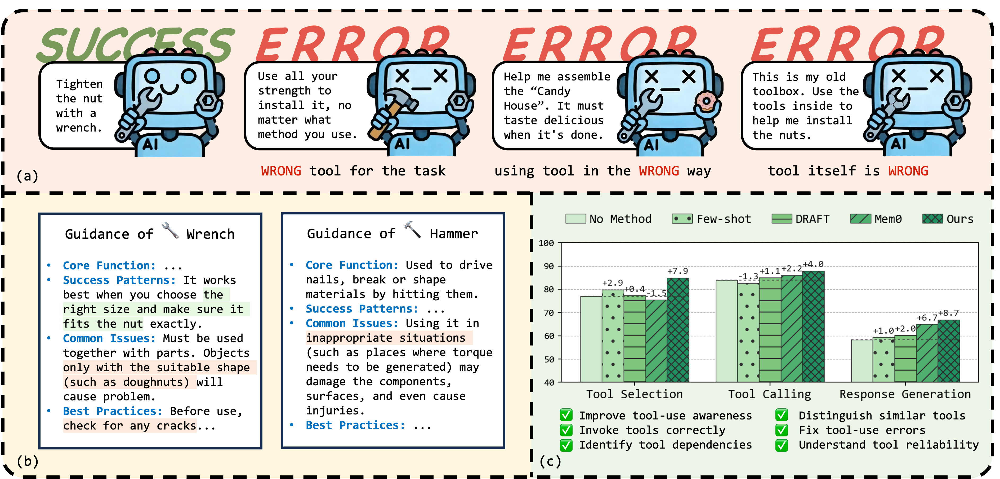
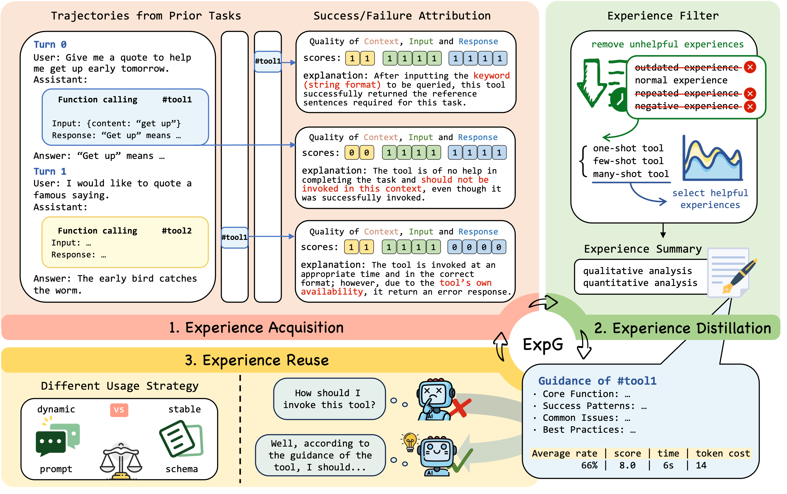

## ExpG：通过经验驱动自适应指导实现鲁棒工具使用的语言模型代理

**语言**：中文 / [English](./README.md)

<p align="center">
  
</p>

### 项目简介

本仓库是论文 **“ExpG: Towards Robust Tool Use in LLM Agents via Experience-Driven Adaptive Guidance”** 的官方实现代码与实验脚本。  
我们的实现 **在底层沿用了内存系统工具包 [Agentscope ReMe](https://github.com/agentscope-ai/ReMe) 提供的统一记忆框架**，并在其之上提出了全新的、面向工具使用的经验驱动指导机制以及相应的多项基准实验管线。

论文中提出的 `ExpG`（Experience-driven Guidance）机制，通过从历史工具调用中挖掘、提炼和复用“经验”，为大模型代理提供关于各类工具的 **能力边界** 与 **最佳实践指导**，从而：

- 在动态或有噪环境下 **更鲁棒地选择和调用工具**；
- 让较小模型在带有经验指导的情况下 **超越更大、但无记忆的大模型基线**；
- 在工具选择、工具调用和响应生成等多个阶段 **带来一致收益**。

---

### 论文信息

- **标题**：*ExpG: Towards Robust Tool Use in LLM Agents via Experience-Driven Adaptive Guidance*  
- **简称**：ExpG  
- **关键词**：Tool Use, Agent Memory, Experience Pool, Robustness, LLM Agents  

论文中核心思想（见 `paper/example_paper.tex`）概括如下：

- 提出一种经验驱动的自适应指导机制 `ExpG`，将历史工具调用视为可分析、可学习的“经验”，而非黑盒事件；
- 将经验生命周期拆分为三个阶段：**经验获取（acquisition）→ 经验蒸馏（distillation）→ 经验复用（reuse）**；
- 在 MetaTool、API-Bank、BFCL-V3 等基准上系统验证，展示了在工具选择、调用质量和最终任务得分上的显著提升；
- 观测到明显的 **“非参数化 scaling 效应”**：在配备 ExpG 经验指导后，小模型能够在多项指标上超越更大的无经验大模型。


<p align="center">
  
</p>

你可以在 `paper/` 目录中找到完整 LaTeX 源文件及论文图表，例如总体框架图：

```text
paper/
  latex/
    figures/
      overview.pdf      # 方法整体框架示意
      ablation.png      # 消融实验
      overlap.png       # 经验覆盖/重叠分析
      ...
```

---

### 仓库结构总览

本仓库包含 ExpG 的核心 **工具记忆实现（`reme_ai/` 中的相关组件）** 以及多套基准实验代码（`experiment/`），整体结构如下：

- **`reme_ai/`**：与 ExpG 直接相关的工具记忆与经验池实现
  - 工具记忆以 **三阶段流水线** 组织代码（经验获取 / 经验蒸馏 / 经验复用），并分布在以下子目录中：
    - `summary/`：侧重经验获取与经验蒸馏阶段，对历史工具调用进行抽取、过滤、聚合与总结，构建可复用的经验单元与“指导片段”；
    - `retrieve/`：侧重经验复用阶段，根据当前工具调用上下文检索合适的经验并返回给上层 Agent；
    - `vector_store/`：为经验单元提供向量化存储与索引支持，是三阶段共享的底层存储；
    - `agent/`：将工具记忆与经验指导注入到代理的工具调用流程中；
    - `service/` 与 `config/`：提供服务封装与默认配置，便于在实验脚本中直接调用上述能力。

- **`experiment/MetaTool/`**：MetaTool 基准上的 ExpG 实验
  - `src/`：MetaTool 任务定义、数据处理、经验生成与调用脚本
  - `quickstart.sh`：一键运行示例脚本（下载模型、构建向量库等）

- **`experiment/api-bank/`**：API-Bank 基准上的工具记忆与 ExpG 实验
  - `apis/`：工具接口定义
  - `API-Bank/`：官方 API-Bank 数据与配置
  - `tool_memory.py` / `tool_manager.py`：工具调用记录与经验池管理
  - `evaluator.py`：API-Bank 评测逻辑与指标计算

- **`experiment/gorilla/`**：基于 Gorilla/BFCL 框架的实验
  - `berkeley-function-call-leaderboard/`：BFCL-V3 相关代码与数据
  - `.../bfcl_eval/tool_memory.py`：BFCL 任务下的工具经验建模
  - `.../bfcl_eval/model_handler/`：不同基座模型的推理封装

- **`paper/`**：论文 LaTeX 源码与图表
  - `example_paper.tex`：主论文源文件
  - `latex/figures/`：所有论文中使用的图片资源

- **根目录其它文件**
  - `pyproject.toml`：Python 包配置（项目名 `reme_ai`）
  - `LICENSE`：开源协议（Apache 2.0）

---

### 环境与安装

- **Python 版本**：推荐使用 **Python 3.12+**（与 `pyproject.toml` 中保持一致）
- 建议使用 conda 或 venv 创建独立环境，例如：

```bash
conda create -n expg python=3.12
conda activate expg
```

在仓库根目录执行安装：

```bash
pip install --upgrade pip
pip install -e .
```

`pyproject.toml` 中的核心依赖为：

- `flowllm[reme]>=0.1.11.6`：底层 LLM / embedding / 向量库适配层

部分实验脚本（例如 MetaTool）还提供了各自的 `requirements.txt`：

```bash
cd experiment/MetaTool
pip install -r requirements.txt
```

---

### ExpG 机制概览

根据论文 `example_paper.tex`，ExpG 将工具调用视为“可学习经验”，并通过三阶段流水线完成经验的获取、提炼与复用：

1. **经验获取（Experience Acquisition）**
   - 从历史工具调用轨迹中分析调用质量（成功/失败、代价、时间等）；
   - 针对不同工具构建结构化的经验单元，记录调用上下文、参数模式和结果。

2. **经验蒸馏（Experience Distillation）**
   - 过滤无效 / 噪声经验，保留具有代表性的调用模式；
   - 基于“等价类”视角对经验进行聚合，覆盖常见模式与稀有失败模式；
   - 使用 LLM 对经验进行总结，形成 **可泛化的文本化指导（guidance）**。

3. **经验复用（Experience Reuse）**
   - 在未来任务中，根据当前工具调用上下文检索相关经验 / 指导；
   - 将经验引导融入到工具选择、参数生成和响应整理等环节；
   - 使得代理在面对动态环境和不完美反馈时仍能保持稳定表现。

---

### 引用与许可证

引用方式与英文版相同，详见 `README.md` 中 “Citation” 一节。  
本项目在 **Apache License 2.0** 协议下发布，详细内容见仓库中的 `LICENSE` 文件。

